# DOSW_LAB6_Rodriguez

# ToDo Full Stack

Laboratorio 6 · Desarrollo y Operaciones de Software (DOSW)
Escuela Colombiana de Ingeniería Julio Garavito
Docente: Rodrigo Gualtero

Aplicación web para gestionar tareas personales. Permite crear, consultar, editar, cambiar de estado y eliminar tareas desde una interfaz en React que consume una API REST en Spring Boot, con persistencia en PostgreSQL ejecutado en Docker.

## Integrante

Natalia Andrea Rodriguez Torres 

- Video de demostración: https://youtu.be/6RhqSoNWYNY?si=JfLxBJZMiZ0GHhpQ
- Informe del laboratorio: [todo-fullstack/docs/informe-laboratorio.md](todo-fullstack/docs/informe-laboratorio.md)
- Informe del laboratorio: [docs/informe-laboratorio.md](docs/informe-laboratorio.md)

## Laboratorio de extensión · Seguridad con Spring Security y JWT

Enunciado: [AppToDo_Security](https://github.com/DOSW-2026-2/AppToDo_Security/blob/main/README.md)  
Rama de trabajo: `feature/jwt-security`  
Tablero de Jira (épica de seguridad): https://parcialdosw.atlassian.net/jira/software/projects/AE/boards/70/timeline

### Estado inicial

Antes de empezar se verificó que el proyecto del laboratorio anterior funcionara completo: PostgreSQL en Docker, la API en Spring Boot y el frontend en React.

- La API expone el CRUD de tareas en `/api/v1/tasks` y el de categorías en `/api/v1/categories`.
- No existe el concepto de usuario: cualquier persona que conozca la URL puede listar, crear, editar o eliminar **todas** las tareas, sin enviar credenciales.
- El frontend muestra directamente la lista de tareas, sin inicio de sesión.
- La base de datos tiene las tablas `tasks` y `categories` (scripts `001` y `002`).


### Alcance de los cambios

Se convierte ToDo en una aplicación con cuentas de usuario y tareas privadas:

- Registro de usuarios (nombre, correo y contraseña) e inicio de sesión con correo y contraseña.
- Contraseñas almacenadas con BCrypt.
- Emisión de un JWT firmado (HS256) con duración de 30 minutos y validación en cada petición protegida.
- Cada usuario solo puede consultar, crear, editar y eliminar sus propias tareas.
- Endpoint administrativo `/api/v1/admin/summary` solo para el rol `ADMIN`.
- Frontend con registro, inicio de sesión, cierre de sesión y token guardado en memoria.
- Pruebas automatizadas de los flujos correctos y de los intentos de acceso indebido.

Fuera del alcance: despliegue en la nube, CI/CD, login con Google, refresh tokens, MFA y recuperación de contraseña.

### Componentes que se modifican

| Capa | Componente | Cambio |
| --- | --- | --- |
| Base de datos | `users` | Nueva tabla (`003_add_users_security.sql`) |
| Base de datos | `tasks` | Nueva llave foránea `user_id` hacia `users` |
| Backend | `UserEntity`, `UserRole`, `UserRepository` | Nuevos |
| Backend | `SecurityConfig` (`SecurityFilterChain`, `PasswordEncoder`, `JwtEncoder`, `JwtDecoder`) | Nuevo |
| Backend | `TokenService` | Nuevo: genera el JWT |
| Backend | `AuthService`, `AuthController` | Nuevos: registro y login |
| Backend | `UserController` (`/users/me`), `AdminController` (`/admin/summary`) | Nuevos |
| Backend | `TaskEntity`, `TaskRepository`, `TaskService`, `TaskController` | Modificados: filtran por el usuario autenticado |
| Backend | `GlobalExceptionHandler` | Modificado: errores 401, 403 y 409 |
| Frontend | `AuthContext`, `LoginForm`, `RegisterForm`, `authApi.js` | Nuevos |
| Frontend | `taskApi.js`, `useTasks`, `TasksPage`, `App.jsx` | Modificados: envían el token y manejan la sesión |

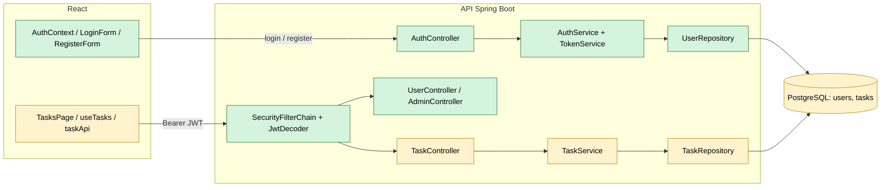

Verde: componente nuevo. Amarillo: componente existente que se modifica.

### Migración de la base de datos

El script [`database/003_add_users_security.sql`](database/003_add_users_security.sql) crea la tabla `users` y agrega a `tasks` la columna `user_id` con su llave foránea. Para no borrar las tareas que ya existían:

1. Se crea el usuario `legacy@todo.local` ("Tareas anteriores").
2. Se agrega `user_id` permitiendo nulos y se asignan a ese usuario todas las tareas existentes.
3. Solo después se aplica `NOT NULL`, la llave foránea y un índice sobre `user_id`.

Todo se ejecuta en una transacción. El usuario `legacy` tiene como hash el valor `LOCKED`, que no corresponde a un hash BCrypt, por lo que nadie puede iniciar sesión con esa cuenta.

```
Get-Content database/003_add_users_security.sql | docker exec -i todo-postgres psql -U todo_user -d todo_db
```


### Cuenta ADMIN para desarrollo local

El registro público siempre crea usuarios con rol `USER` y no acepta el campo `role`. Para probar `/api/v1/admin/summary` en local se registra una cuenta normal desde la aplicación y luego se promueve directamente en la base de datos con el script [`database/dev/promote_admin.sql`](database/dev/promote_admin.sql):

```
Get-Content database/dev/promote_admin.sql | docker exec -i todo-postgres psql -U todo_user -d todo_db -v email=admin@todo.local
```

El rol viaja dentro del JWT, así que después de promover la cuenta hay que iniciar sesión de nuevo para obtener un token con rol `ADMIN`. Este script es solo para desarrollo; no se publican contraseñas reales.

### Diagramas de la solución

Los diagramas corresponden a la implementación final de la rama `feature/jwt-security`.

#### C4 · Nivel 1 · Contexto

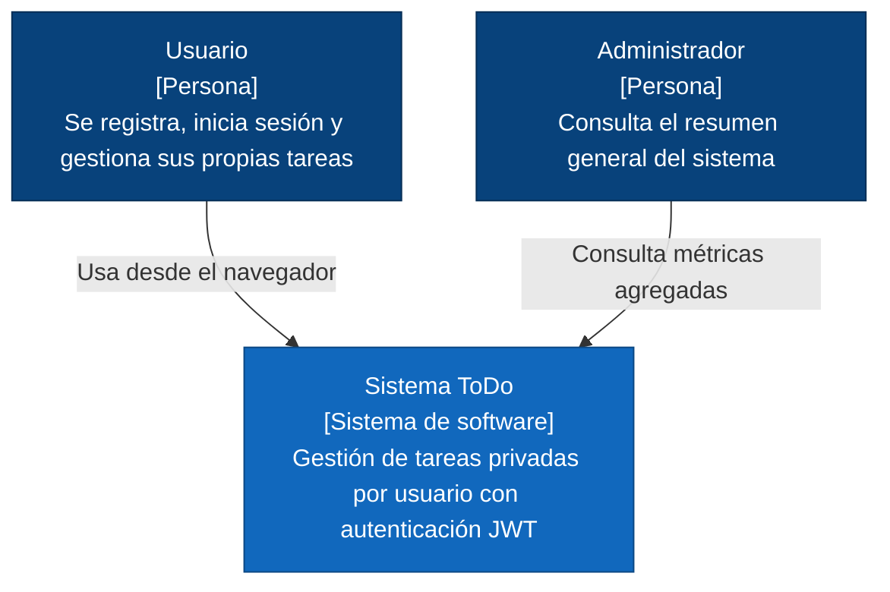

#### C4 · Nivel 2 · Contenedores

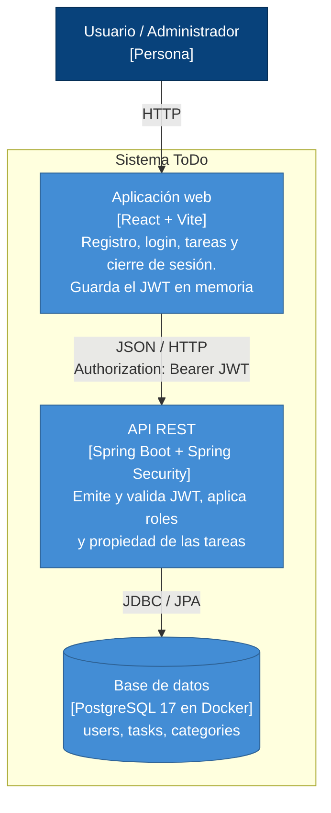

#### C4 · Nivel 3 · Componentes del back-end

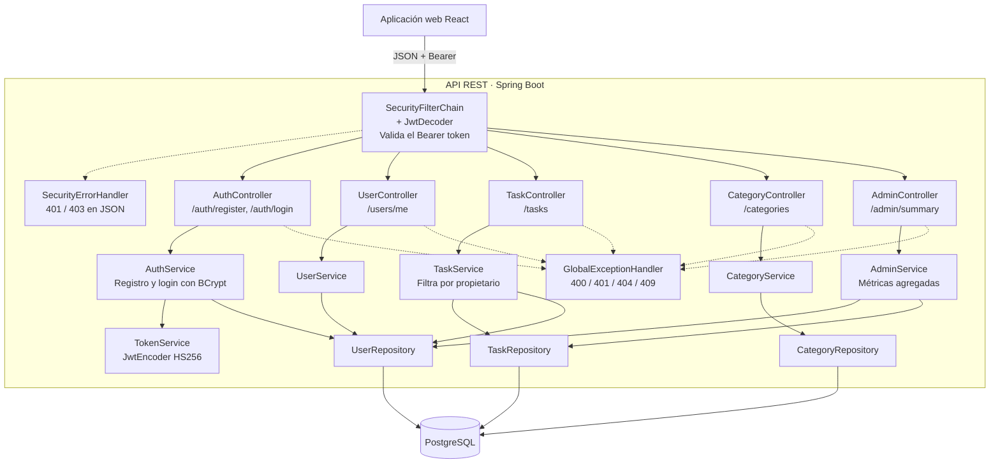

#### C4 · Nivel 3 · Componentes del front-end

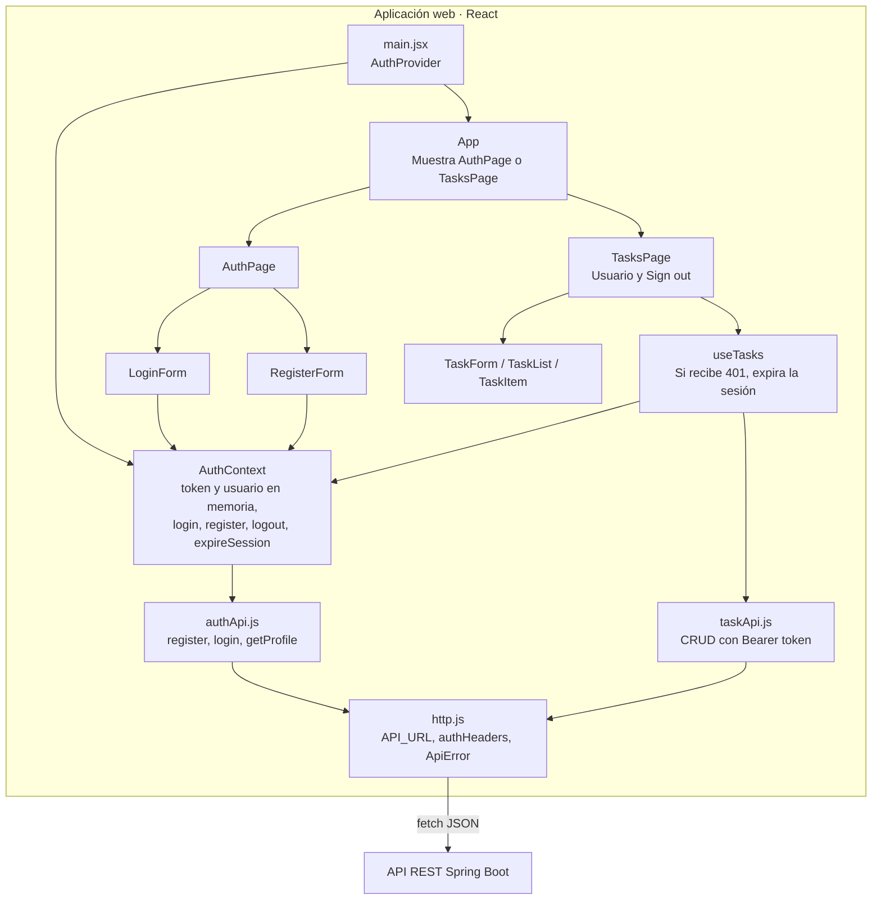

#### Diagrama de clases (back-end)

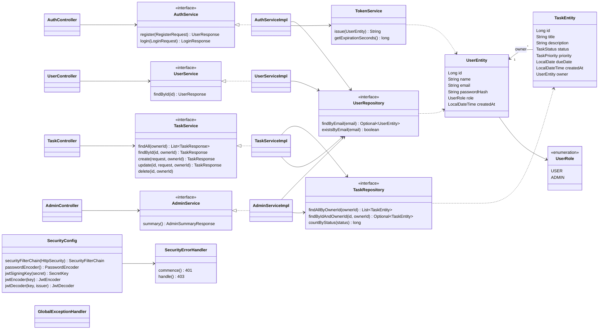

DTOs: `RegisterRequest`, `LoginRequest`, `LoginResponse`, `UserResponse`, `AdminSummaryResponse`, `TaskCreateRequest`, `TaskUpdateRequest`, `TaskResponse`. Excepciones: `EmailAlreadyRegisteredException` (409), `InvalidCredentialsException` (401), `TaskNotFoundException` y `UserNotFoundException` (404), manejadas en `GlobalExceptionHandler`.

#### Modelo entidad-relación

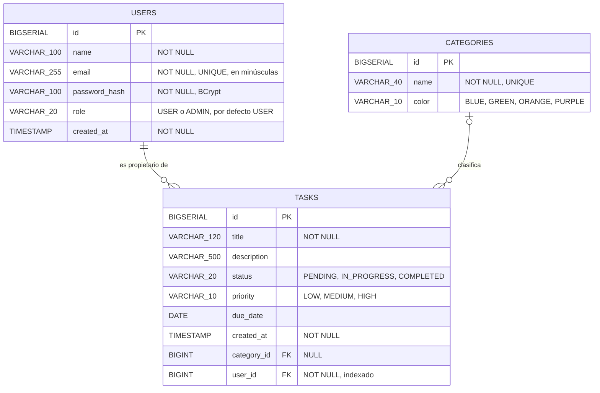

Un usuario tiene muchas tareas y cada tarea pertenece a exactamente un usuario (`user_id NOT NULL`, `ON DELETE CASCADE`). La relación con `categories` viene del requisito anterior y es opcional.

### Contrato de endpoints

Base: `http://localhost:8080/api/v1`. Las rutas autenticadas requieren la cabecera `Authorization: Bearer <JWT>`.

| Método | Endpoint | Acceso | Respuestas |
| --- | --- | --- | --- |
| `POST` | `/auth/register` | Público | `201`, `400`, `409` |
| `POST` | `/auth/login` | Público | `200` con JWT, `400`, `401` |
| `GET` | `/users/me` | Autenticado | `200`, `401` |
| `GET` | `/tasks` | Autenticado | `200` (solo tareas propias), `401` |
| `GET` | `/tasks/{id}` | Autenticado | `200`, `401`, `404` (inexistente o ajena) |
| `POST` | `/tasks` | Autenticado | `201` (propietario = usuario del token), `400`, `401` |
| `PUT` | `/tasks/{id}` | Autenticado | `200`, `400`, `401`, `404` (inexistente o ajena) |
| `DELETE` | `/tasks/{id}` | Autenticado | `204`, `401`, `404` (inexistente o ajena) |
| `GET` | `/categories`, `/categories/{id}` | Autenticado | `200`, `401`, `404` |
| `POST`, `PUT` | `/categories`, `/categories/{id}` | Autenticado | `201`/`200`, `400`, `401`, `404` |
| `GET` | `/admin/summary` | `ADMIN` | `200`, `401`, `403` |

Las categorías son un catálogo compartido del requisito anterior: exigen autenticación, pero no tienen propietario.

**Registro**

```
POST /api/v1/auth/register
Content-Type: application/json

{ "name": "Ana Pérez", "email": "ana@example.com", "password": "ContrasenaDemo123!" }
```

```
201 Created
{ "id": 1, "name": "Ana Pérez", "email": "ana@example.com", "role": "USER" }
```

**Inicio de sesión**

```
POST /api/v1/auth/login
Content-Type: application/json

{ "email": "ana@example.com", "password": "ContrasenaDemo123!" }
```

```
200 OK
{ "tokenType": "Bearer", "accessToken": "<JWT_FIRMADO>", "expiresIn": 1800 }
```

**Resumen administrativo**

```
GET /api/v1/admin/summary
Authorization: Bearer <JWT_DE_ADMIN>
```

```
200 OK
{ "totalUsers": 4, "totalTasks": 5, "tasksByStatus": { "PENDING": 5, "IN_PROGRESS": 0, "COMPLETED": 0 } }
```

**Política de errores.** Todas las respuestas de error tienen el formato `{ "status": ..., "message": ... }`.

| Situación | Código |
| --- | --- |
| Datos inválidos en registro, login o tareas | `400 Bad Request` |
| Registro con correo ya existente | `409 Conflict` |
| Login inválido | `401 Unauthorized` |
| Falta de token, token expirado, alterado o de otro emisor | `401 Unauthorized` |
| JWT válido sin el rol requerido | `403 Forbidden` |
| Tarea inexistente o perteneciente a otro usuario | `404 Not Found` |

### Flujo de autenticación JWT

**Inicio de sesión**

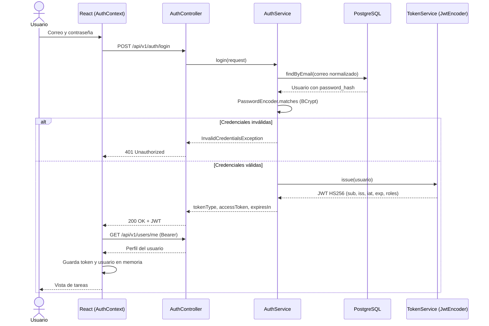

**Petición protegida**

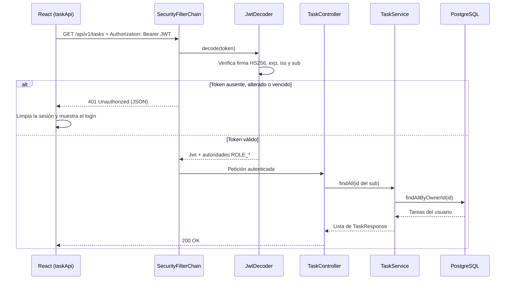

### Decisiones de seguridad

| Tema | Decisión | Motivo |
| --- | --- | --- |
| Firma del JWT | HS256 con una llave simétrica. `NimbusJwtEncoder` y `NimbusJwtDecoder` usan el mismo `SecretKey`. | El backend emite y valida sus propios tokens; no hay terceros que necesiten una llave pública. |
| Llave de firma | Se lee de `JWT_SECRET` (variable de entorno o `backend/.env`, ignorado por Git). Si tiene menos de 32 bytes la aplicación no arranca. | No hay secretos en el repositorio y se evita una llave débil para HMAC-SHA256. |
| Contenido del token | `sub` (id del usuario), `iss` (`todo-api`), `iat`, `exp`, `email` y `roles`. | `sub` usa el id porque no cambia; los roles se convierten en autoridades `ROLE_USER` / `ROLE_ADMIN`. |
| Validación | En cada petición se verifican la firma, `exp`, `iss` y que exista `sub`. | Decodificar el token no basta: un JWT alterado o de otro emisor debe rechazarse. |
| Duración | 30 minutos, sin refresh token. | Requisito del laboratorio; al vencer el usuario vuelve a iniciar sesión. |
| Sesión | `SessionCreationPolicy.STATELESS`, CSRF deshabilitado. | La API no usa cookies ni sesión de servidor; la identidad viaja solo en la cabecera `Authorization`. |
| Almacenamiento en el frontend | El token y el usuario se guardan en el estado de React (`AuthContext`), no en `localStorage`. | Un script inyectado no encuentra el token persistido en el navegador. Como consecuencia, al recargar la página se pierde la sesión. |
| Cierre de sesión | Solo en el cliente: se borra el token del estado y se desmonta la vista de tareas. | El JWT no se revoca en el servidor; si alguien lo copió, sigue siendo válido hasta que expire. En un sistema real se usaría una lista de revocación o tokens cortos con refresh token. |
| Contraseñas | BCrypt (`BCryptPasswordEncoder`), entre 8 y 72 caracteres. | Hash lento y con sal; 72 es el límite que procesa BCrypt. Nunca se devuelve la contraseña ni su hash. |
| Registro | El rol siempre es `USER`; el campo `role` enviado por el cliente se ignora. El correo se normaliza a minúsculas. | Ninguna petición pública puede elevar privilegios ni crear cuentas duplicadas con mayúsculas. |
| Rol `ADMIN` | Solo se asigna con el script de desarrollo `database/dev/promote_admin.sql`. `/api/v1/admin/**` exige `hasRole("ADMIN")`. | La autorización por rol se hace en el backend, por URL. |
| Propiedad de las tareas | El propietario se toma del `sub` del token y las consultas filtran por `id` y `owner`. | El cliente no puede elegir el dueño; una tarea ajena responde `404` para no revelar que existe. |
| CORS | Solo se permite el origen `http://localhost:5173`, con los métodos `GET`, `POST`, `PUT`, `DELETE`, `OPTIONS` y la cabecera `Authorization`. | El frontend local puede llamar a la API; otros orígenes no. |
| Errores | `401` y `403` se responden en JSON con el mismo formato que el resto de la API (`SecurityErrorHandler`). | El frontend distingue sesión vencida (`401`) de falta de permisos (`403`). |
| Logs | No se registran tokens, contraseñas ni la cabecera `Authorization`. | Evita filtrar credenciales en los registros. |

### Pruebas de seguridad

Back-end (desde `backend`, no necesita Docker: las pruebas que levantan la aplicación completa usan H2 en memoria con el perfil `test`):

```
mvn clean verify
```

Front-end (desde `frontend`):

```
npm test
```

| Tipo | Clases | Pruebas |
| --- | --- | --- |
| Unitarias (Mockito) | `AuthServiceTest`, `TaskServiceTest`, `AdminServiceTest`, `TokenServiceTest`, `CategoryServiceTest` | 34 |
| Controladores con Spring Security (MockMvc) | `AuthControllerTest`, `TaskControllerTest`, `UserControllerTest`, `AdminControllerTest`, `CategoryControllerTest` | 33 |
| Repositorio (JPA) | `TaskRepositoryTest` | 5 |
| Integración HTTP + seguridad + persistencia | `SecurityIntegrationTest`, `TodoApiApplicationTests` | 17 |
| Front-end (Vitest + Testing Library) | `App.test`, `LoginForm.test`, `RegisterForm.test`, `TasksPage.test`, `taskApi.test`, `authApi.test`, `TaskForm.test`, `TaskList.test` | 34 |

Total: 89 pruebas en el back-end y 34 en el front-end.

#### Matriz de pruebas

| ID | Prueba | Resultado esperado | Dónde se verifica |
| --- | --- | --- | --- |
| PT-01 | Registrar usuario válido | `201`, rol `USER` | `SecurityIntegrationTest.pt01_pt03…`, `AuthControllerTest`, `AuthServiceTest` |
| PT-02 | Correo duplicado | `409`, sin duplicados | `SecurityIntegrationTest.pt02…`, `AuthControllerTest`, `AuthServiceTest` |
| PT-03 | Guardar contraseña | Hash BCrypt, no texto plano | `SecurityIntegrationTest.pt01_pt03…`, `AuthServiceTest` |
| PT-04 | Login correcto | `200` con token firmado | `SecurityIntegrationTest.pt04…`, `AuthControllerTest`, `TokenServiceTest` |
| PT-05 | Login incorrecto | `401` sin token | `SecurityIntegrationTest.pt05…`, `AuthServiceTest`, `AuthControllerTest` |
| PT-06 | Tareas sin token | `401` | `SecurityIntegrationTest.pt06…`, `TaskControllerTest` |
| PT-07 | Tareas con token válido | `200`, solo las propias | `SecurityIntegrationTest.pt07…`, `TaskRepositoryTest`, `TaskServiceTest` |
| PT-08 | Token modificado | `401` | `SecurityIntegrationTest.pt08…`, `TokenServiceTest` |
| PT-09 | Token expirado | `401` | `SecurityIntegrationTest.pt09…`, `TokenServiceTest` |
| PT-10 | Consultar tarea ajena | `404` sin datos | `SecurityIntegrationTest.pt10…`, `TaskServiceTest`, `TaskRepositoryTest` |
| PT-11 | Modificar tarea ajena | `404`, sin cambios en BD | `SecurityIntegrationTest.pt11…`, `TaskServiceTest` |
| PT-12 | Eliminar tarea ajena | `404`, sin cambios en BD | `SecurityIntegrationTest.pt12…`, `TaskServiceTest` |
| PT-13 | Crear tarea autenticada | Propietario = usuario del token | `SecurityIntegrationTest.pt13…`, `TaskServiceTest` |
| PT-14 | `USER` en `/admin/summary` | `403` | `SecurityIntegrationTest.pt14…`, `AdminControllerTest` |
| PT-15 | `ADMIN` en `/admin/summary` | `200` | `SecurityIntegrationTest.pt15…`, `AdminControllerTest` |
| PT-16 | Cerrar sesión en React | Token y tareas desaparecen de la UI | `App.test` (PT-16), `TasksPage.test` |
| PT-17 | Respuesta `401` en React | Vuelve al inicio de sesión | `App.test` (PT-17), `TasksPage.test` |
| PT-18 | Otro usuario inicia sesión | Solo ve sus tareas | `App.test` (PT-18) |

#### Cobertura (JaCoCo)

Reporte en `backend/target/site/jacoco/index.html` después de `mvn clean verify`.

| Métrica | Cobertura |
| --- | --- |
| Instrucciones | 95,3 % |
| Ramas | 87,5 % |
| Líneas | 91,5 % |
| Paquete `security` | 100 % de instrucciones |

Al iniciar este laboratorio el módulo de categorías del requisito anterior no tenía pruebas; se agregaron `CategoryServiceTest` y `CategoryControllerTest` para mantener la cobertura por encima del 80 %. La cobertura no reemplaza los escenarios de seguridad: estos se validan explícitamente en la matriz anterior.

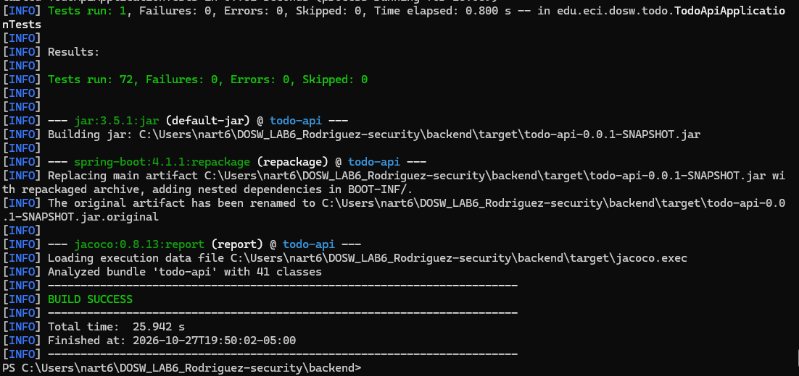

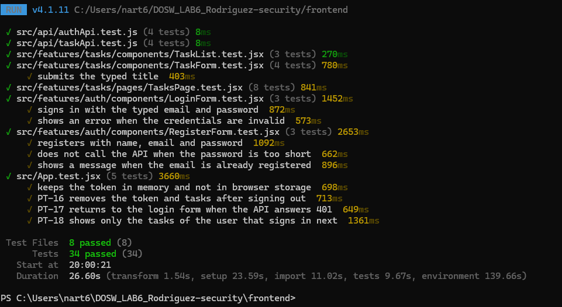

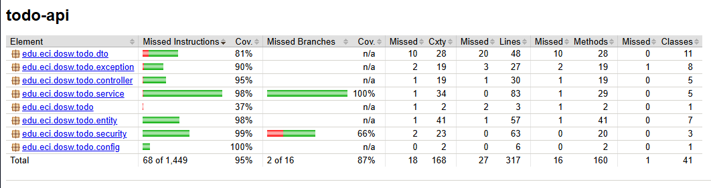

### Verificación manual de punta a punta

Recorrido realizado con PostgreSQL en Docker, la API en Spring Boot y el frontend en React, todo en local.

**1. Registro e inicio de sesión de Ana y Luis.** Cada uno ve únicamente sus tareas.

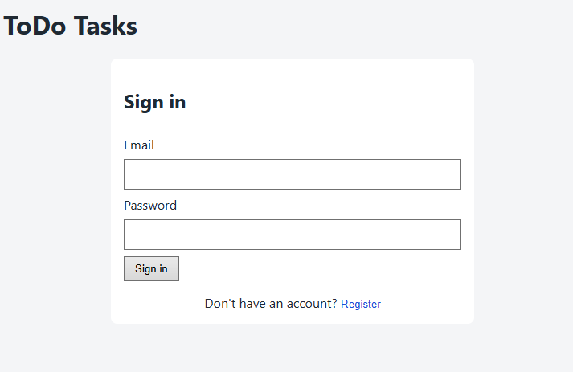

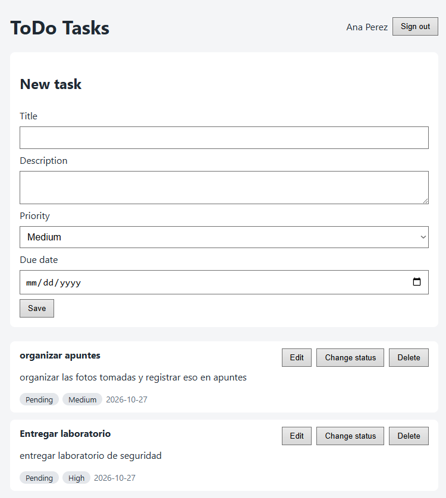

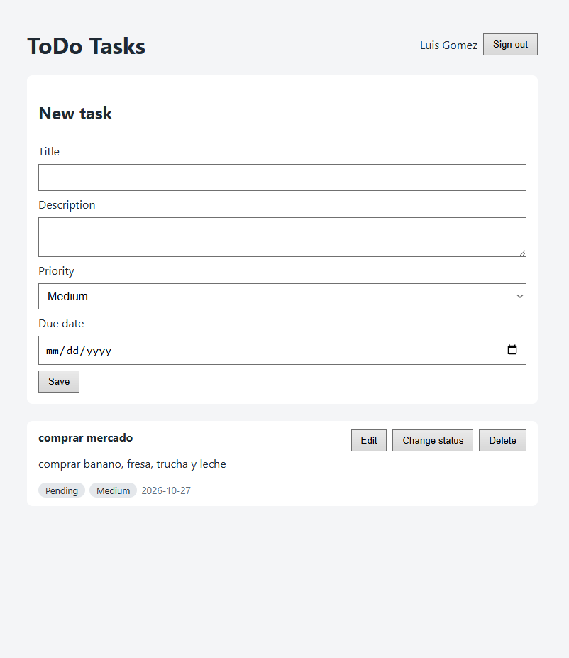

**2. Contraseñas almacenadas con BCrypt.** La cuenta `legacy` tiene `LOCKED`, que no es un hash válido.

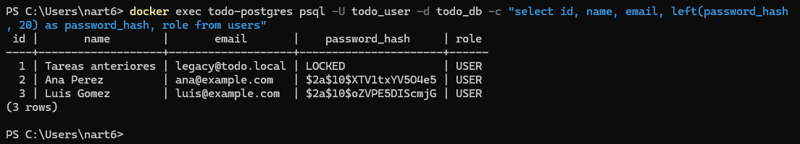

**3. Luis intenta modificar, eliminar y consultar la tarea 4 de Ana usando su propio JWT.** El servidor responde `404` en los tres casos y la tarea de Ana permanece igual.

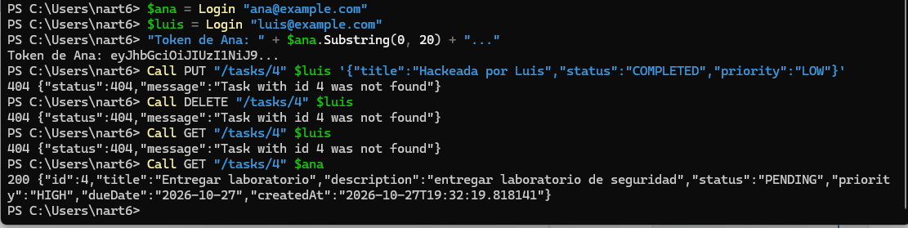

**4. Ruta protegida sin token y con un token alterado.** Ambas responden `401`.

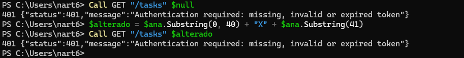

**5. `/api/v1/admin/summary` con `USER` y con `ADMIN`.** Ana (`USER`) recibe `403`; la cuenta de administrador se registra como `USER`, se promueve con el script de desarrollo y, tras iniciar sesión de nuevo, recibe `200` con las métricas agregadas.

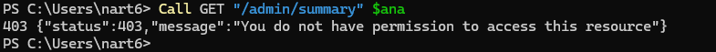

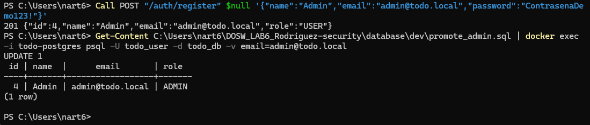

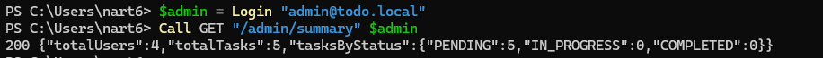

**6. Propietarios en PostgreSQL.** Cada tarea está relacionada con su usuario y la tarea de Ana sigue sin cambios después del intento de Luis.

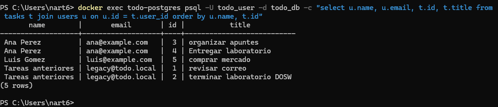

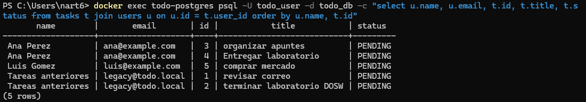

**7. Pruebas automatizadas.** Ver la sección anterior: 89 pruebas en el back-end y 34 en el front-end.

## Tecnologías

| Capa | Tecnología |
| --- | --- |
| Front-end | React + Vite, Vitest, React Testing Library |
| Back-end | Java 21, Spring Boot 4, Maven, Spring Data JPA, Bean Validation |
| Seguridad | Spring Security, OAuth2 Resource Server (JWT con Nimbus, HS256), BCrypt |
| Base de datos | PostgreSQL 17 (imagen oficial `postgres:17-alpine` en Docker) |
| Pruebas back-end | JUnit 5, Mockito, AssertJ, MockMvc, Spring Security Test, H2 (perfil `test`) |
| Cobertura | JaCoCo |

## Arquitectura

```
React (AuthContext, formularios, hooks, authApi.js, taskApi.js)
        │  HTTP + JSON + Authorization: Bearer JWT
        ▼
SecurityFilterChain (valida el JWT)
        │
        ▼
REST Controller  →  Service  →  Repository  →  Entity JPA
                                                    │
                                                    ▼
                                              PostgreSQL (Docker)
```

- **Seguridad:** `SecurityConfig` define las rutas públicas, el rol `ADMIN` y la validación del JWT; `TokenService` emite los tokens y `SecurityErrorHandler` responde 401/403 en JSON.
- **Controller:** expone `/auth`, `/users`, `/tasks`, `/categories` y `/admin`; valida la entrada con `@Valid` y obtiene la identidad del usuario del `Jwt` autenticado.
- **Service:** contiene la lógica de negocio (registro con BCrypt, login, tareas filtradas por propietario, métricas administrativas, conversión Entity ↔ DTO).
- **Repository:** acceso a datos con `JpaRepository`; las consultas de tareas filtran por `id` y propietario.
- **Entity / DTO:** `UserEntity` y `TaskEntity` se mapean a `users` y `tasks`; los DTOs definen lo que entra y sale de la API, sin exponer el hash de la contraseña.
- **Manejo de errores:** `GlobalExceptionHandler` convierte las excepciones en respuestas 400, 401, 404 y 409 con formato `{ "status": ..., "message": ... }`.

## Estructura del repositorio

```
DOSW_LAB6_Rodriguez/
├── backend/                API Spring Boot
│   ├── .env.example        Variables necesarias (sin valores)
│   └── src/main/java/edu/eci/dosw/todo/
│       ├── controller/     Auth, User, Task, Category, Admin
│       ├── security/       SecurityConfig, TokenService, SecurityErrorHandler
│       ├── service/        Lógica de negocio
│       ├── repository/     Spring Data JPA
│       ├── entity/         UserEntity, TaskEntity, enums
│       ├── dto/            Peticiones y respuestas
│       └── exception/      Excepciones y GlobalExceptionHandler
├── frontend/               Aplicación React + Vite
│   └── src/
│       ├── api/            http.js, authApi.js, taskApi.js
│       └── features/
│           ├── auth/       AuthContext, LoginForm, RegisterForm, AuthPage
│           └── tasks/      TasksPage, useTasks, componentes de tareas
├── database/
│   ├── 001_create_schema.sql
│   ├── 002_add_categories.sql
│   ├── 003_add_users_security.sql
│   └── dev/promote_admin.sql   Solo para desarrollo local
└── docs/
    ├── evidence/           Capturas de evidencia (security/ para este laboratorio)
    ├── informe-laboratorio.md
    └── informe-seguridad-jwt.md
```

## Modelo de datos

El diagrama entidad-relación está en la sección [Diagramas de la solución](#diagramas-de-la-solución).

**Usuario (`users`)**

| Campo | Tipo | Obligatorio | Valor por defecto |
| --- | --- | --- | --- |
| `id` | Long | Sí | Generado |
| `name` | String (máx. 100) | Sí | |
| `email` | String (máx. 255, único, en minúsculas) | Sí | |
| `passwordHash` | String (hash BCrypt) | Sí | |
| `role` | `USER`, `ADMIN` | Sí | `USER` |
| `createdAt` | LocalDateTime | Sí | Fecha y hora actual |

**Tarea (`tasks`)**

| Campo | Tipo | Obligatorio | Valor por defecto |
| --- | --- | --- | --- |
| `id` | Long | Sí | Generado |
| `title` | String (máx. 120) | Sí | |
| `description` | String (máx. 500) | No | |
| `status` | `PENDING`, `IN_PROGRESS`, `COMPLETED` | Sí | `PENDING` |
| `priority` | `LOW`, `MEDIUM`, `HIGH` | Sí | `MEDIUM` |
| `dueDate` | LocalDate | No | |
| `createdAt` | LocalDateTime | Sí | Fecha y hora actual |
| `owner` (`user_id`) | Usuario propietario | Sí | Usuario del token |

## Requisitos previos

- Docker Desktop
- Java 21
- Maven (o el wrapper `mvnw` incluido)
- Node.js y npm

## Cómo ejecutar el proyecto

Se necesitan tres terminales.

### 1. Base de datos (primera vez)

```
docker pull postgres:17-alpine
docker volume create todo-postgres-data
docker run -d --name todo-postgres -e POSTGRES_DB=todo_db -e POSTGRES_USER=todo_user -e POSTGRES_PASSWORD=todo_password -p 5432:5432 -v todo-postgres-data:/var/lib/postgresql/data postgres:17-alpine
Get-Content database/001_create_schema.sql | docker exec -i todo-postgres psql -U todo_user -d todo_db
Get-Content database/002_add_categories.sql | docker exec -i todo-postgres psql -U todo_user -d todo_db
Get-Content database/003_add_users_security.sql | docker exec -i todo-postgres psql -U todo_user -d todo_db
```

Si el contenedor ya existe, basta con iniciarlo. Si viene del laboratorio anterior, se aplican solo los scripts que falten (`002` y `003`); el `003` conserva las tareas existentes asignándolas al usuario `legacy@todo.local`.

```
docker start todo-postgres
```

### 2. Back-end

La llave de firma del JWT no está en el repositorio. Se configura una sola vez en el archivo `backend/.env`, que Git ignora (ver [`backend/.env.example`](backend/.env.example)). Para generar una llave aleatoria desde PowerShell:

```
cd backend
"JWT_SECRET=$([Convert]::ToBase64String((1..48 | ForEach-Object { Get-Random -Maximum 256 })))" | Out-File -Encoding ascii .env
```

Luego se inicia la API:

```
mvn spring-boot:run
```

La API queda disponible en `http://localhost:8080`.

| Variable | Obligatoria | Uso | Valor por defecto |
| --- | --- | --- | --- |
| `JWT_SECRET` | Sí | Llave HMAC para firmar y validar los JWT (mínimo 32 bytes) | Ninguno: sin ella la aplicación no arranca |
| `DB_URL` | No | URL JDBC de PostgreSQL | `jdbc:postgresql://localhost:5432/todo_db` |
| `DB_USER` | No | Usuario de la base de datos | `todo_user` |
| `DB_PASSWORD` | No | Contraseña de la base de datos | `todo_password` (solo para el contenedor local) |

Las variables pueden definirse en `backend/.env` o como variables de entorno del sistema.

### 3. Front-end

```
cd frontend
npm install
npm run dev
```

La aplicación queda disponible en `http://localhost:5173`. Consume la API en `http://localhost:8080/api/v1`; para usar otra URL se define `VITE_API_URL` (por ejemplo, en `frontend/.env.local`).

El token se guarda solo en memoria, así que al recargar la página hay que iniciar sesión de nuevo.

## API REST

El contrato completo, con el nivel de acceso de cada endpoint y la política de errores, está en [Contrato de endpoints](#contrato-de-endpoints). Todas las rutas de tareas requieren un JWT válido y operan solo sobre las tareas del usuario autenticado.

Ejemplo de creación:

```
POST /api/v1/tasks
Authorization: Bearer <JWT_FIRMADO>
Content-Type: application/json

{
  "title": "Terminar laboratorio DOSW",
  "description": "Completar pruebas del backend",
  "priority": "HIGH",
  "dueDate": "2026-09-25"
}
```

Ejemplo de error:

```
{ "status": 404, "message": "Task with id 99 was not found" }
```
## Requisito anterior · Categorías

Las historias de usuario del requisito de categorías se encuentran en Jira: https://parcialdosw.atlassian.net/jira/software/projects/AE/boards/70/timeline?atlOrigin=eyJpIjoiODRkZmJhZTYxMjU3NDM0N2JhYTI3YmQwYzFjOWJkYTgiLCJwIjoiaiJ9

## Diagramas C4 del laboratorio anterior

Estos diagramas corresponden a la versión sin autenticación. Los diagramas actualizados con la seguridad JWT están en [Diagramas de la solución](#diagramas-de-la-solución).

Diagrama de contexto:


Link de donde fue realizado: https://lucid.app/lucidchart/9a371200-d70f-4c62-9cec-60442e0f5a12/edit?viewport_loc=-199%2C-183%2C2096%2C1159%2C0_0&invitationId=inv_71fcfe89-a623-4dda-9718-c33c5bb0b29f

Diagrama contenedores:


Link de donde fue realizado: https://lucid.app/lucidchart/eca753a9-0322-4724-8531-a94fe01810a4/edit?viewport_loc=-137%2C-57%2C1669%2C1159%2C0_0&invitationId=inv_eb3c0ace-f843-47fd-b452-cfe4aa538766

Diagrama de componentes backend:


Diagrama de componentes frontend:


Link de donde fueron realizados: https://lucid.app/lucidchart/11e63f3c-bdc9-4a8b-8b8a-f71888644489/edit?viewport_loc=-18%2C296%2C3144%2C1738%2C0_0&invitationId=inv_3e241ff6-bb87-4592-b04d-54d4e4df1726

## Pruebas

Los comandos, la matriz PT-01 a PT-18 y la cobertura están en [Pruebas de seguridad](#pruebas-de-seguridad).

## Evidencias

Las capturas del laboratorio de seguridad están en [docs/evidence/security](docs/evidence/security).

| Archivo | Evidencia |
| --- | --- |
| `00-estado-inicial-crud.png`, `00-api-sin-token.png` | Estado inicial: CRUD sin autenticación |
| `01-migracion-003.png` | Migración `003` aplicada sin perder tareas |
| `02-react-login.png` | Pantalla de inicio de sesión |
| `03-react-tareas-ana.png`, `04-react-tareas-luis.png` | Cada usuario ve solo sus tareas |
| `05-bd-tareas-por-usuario.png` | Tareas con propietarios distintos en PostgreSQL |
| `06-bd-password-hash.png` | Contraseñas almacenadas con BCrypt |
| `07-backend-tests.png`, `08-frontend-tests.png` | Pruebas automatizadas |
| `09-jacoco.png` | Reporte de cobertura |
| `10-luis-tarea-ana.png` | Acceso a una tarea ajena rechazado con 404 |
| `11-sin-token-y-alterado.png` | Peticiones sin token y con token alterado rechazadas con 401 |
| `12-admin-como-user.png`, `13-promover-admin.png`, `14-admin-como-admin.png` | Recurso administrativo con `USER` (403) y `ADMIN` (200) |
| `15-bd-despues-del-ataque.png` | Datos intactos después del intento de acceso indebido |

Las capturas del laboratorio anterior están en [docs/evidence](docs/evidence):

| N.º | Evidencia |
| --- | --- |
| 01 | PostgreSQL en Docker |
| 02 | Tabla `tasks` |
| 03 | Pruebas del Service |
| 04 | Pruebas del Controller |
| 05 | Reporte JaCoCo |
| 06 | API funcionando |
| 07 | Aplicación React |
| 08 | Creación desde React |
| 09 | Edición desde React |
| 10 | Eliminación desde React |
| 11 | Pruebas del front-end |

## Detener los servicios

```
docker stop todo-postgres
```

Los datos se conservan en el volumen `todo-postgres-data`. Para eliminar también los datos:

```
docker rm -f todo-postgres
docker volume rm todo-postgres-data
```
