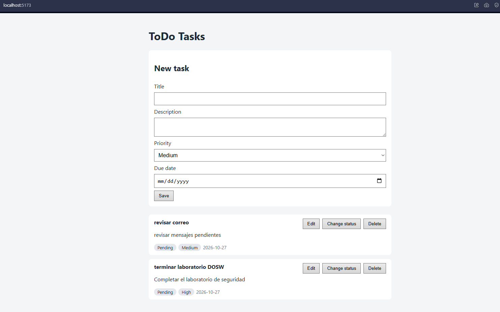
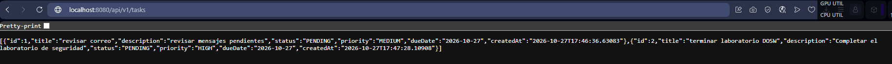
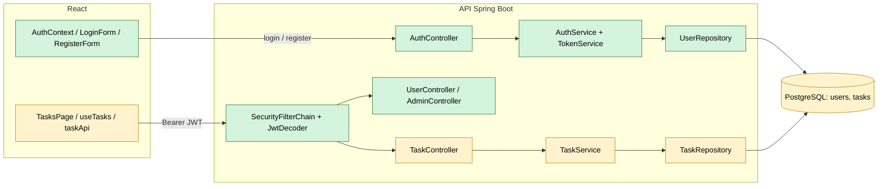
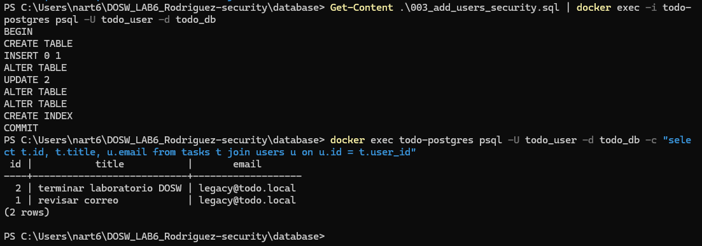

# DOSW_LAB6_Rodriguez

# ToDo Full Stack

Laboratorio 6 · Desarrollo y Operaciones de Software (DOSW)
Escuela Colombiana de Ingeniería Julio Garavito
Docente: Rodrigo Gualtero

Aplicación web para gestionar tareas personales. Permite crear, consultar, editar, cambiar de estado y eliminar tareas desde una interfaz en React que consume una API REST en Spring Boot, con persistencia en PostgreSQL ejecutado en Docker.

## Integrante

Natalia Andrea Rodriguez Torres 

- Video de demostración: https://youtu.be/6RhqSoNWYNY?si=JfLxBJZMiZ0GHhpQ
- Informe del laboratorio: [todo-fullstack/docs/informe-laboratorio.md](todo-fullstack/docs/informe-laboratorio.md)
- Informe del laboratorio: [docs/informe-laboratorio.md](docs/informe-laboratorio.md)

## Laboratorio de extensión · Seguridad con Spring Security y JWT

Enunciado: [AppToDo_Security](https://github.com/DOSW-2026-2/AppToDo_Security/blob/main/README.md)  
Rama de trabajo: `feature/jwt-security`  
Tablero de Jira (épica de seguridad): https://parcialdosw.atlassian.net/jira/software/projects/AE/boards/70/timeline

### Estado inicial

Antes de empezar se verificó que el proyecto del laboratorio anterior funcionara completo: PostgreSQL en Docker, la API en Spring Boot y el frontend en React.

- La API expone el CRUD de tareas en `/api/v1/tasks` y el de categorías en `/api/v1/categories`.
- No existe el concepto de usuario: cualquier persona que conozca la URL puede listar, crear, editar o eliminar **todas** las tareas, sin enviar credenciales.
- El frontend muestra directamente la lista de tareas, sin inicio de sesión.
- La base de datos tiene las tablas `tasks` y `categories` (scripts `001` y `002`).





### Alcance de los cambios

Se convierte ToDo en una aplicación con cuentas de usuario y tareas privadas:

- Registro de usuarios (nombre, correo y contraseña) e inicio de sesión con correo y contraseña.
- Contraseñas almacenadas con BCrypt.
- Emisión de un JWT firmado (HS256) con duración de 30 minutos y validación en cada petición protegida.
- Cada usuario solo puede consultar, crear, editar y eliminar sus propias tareas.
- Endpoint administrativo `/api/v1/admin/summary` solo para el rol `ADMIN`.
- Frontend con registro, inicio de sesión, cierre de sesión y token guardado en memoria.
- Pruebas automatizadas de los flujos correctos y de los intentos de acceso indebido.

Fuera del alcance: despliegue en la nube, CI/CD, login con Google, refresh tokens, MFA y recuperación de contraseña.

### Componentes que se modifican

| Capa | Componente | Cambio |
| --- | --- | --- |
| Base de datos | `users` | Nueva tabla (`003_add_users_security.sql`) |
| Base de datos | `tasks` | Nueva llave foránea `user_id` hacia `users` |
| Backend | `UserEntity`, `UserRole`, `UserRepository` | Nuevos |
| Backend | `SecurityConfig` (`SecurityFilterChain`, `PasswordEncoder`, `JwtEncoder`, `JwtDecoder`) | Nuevo |
| Backend | `TokenService` | Nuevo: genera el JWT |
| Backend | `AuthService`, `AuthController` | Nuevos: registro y login |
| Backend | `UserController` (`/users/me`), `AdminController` (`/admin/summary`) | Nuevos |
| Backend | `TaskEntity`, `TaskRepository`, `TaskService`, `TaskController` | Modificados: filtran por el usuario autenticado |
| Backend | `GlobalExceptionHandler` | Modificado: errores 401, 403 y 409 |
| Frontend | `AuthContext`, `LoginForm`, `RegisterForm`, `authApi.js` | Nuevos |
| Frontend | `taskApi.js`, `useTasks`, `TasksPage`, `App.jsx` | Modificados: envían el token y manejan la sesión |



Verde: componente nuevo. Amarillo: componente existente que se modifica.

### Migración de la base de datos

El script [`database/003_add_users_security.sql`](database/003_add_users_security.sql) crea la tabla `users` y agrega a `tasks` la columna `user_id` con su llave foránea. Para no borrar las tareas que ya existían:

1. Se crea el usuario `legacy@todo.local` ("Tareas anteriores").
2. Se agrega `user_id` permitiendo nulos y se asignan a ese usuario todas las tareas existentes.
3. Solo después se aplica `NOT NULL`, la llave foránea y un índice sobre `user_id`.

Todo se ejecuta en una transacción. El usuario `legacy` tiene como hash el valor `LOCKED`, que no corresponde a un hash BCrypt, por lo que nadie puede iniciar sesión con esa cuenta.

```
Get-Content database/003_add_users_security.sql | docker exec -i todo-postgres psql -U todo_user -d todo_db
```



### Cuenta ADMIN para desarrollo local

El registro público siempre crea usuarios con rol `USER` y no acepta el campo `role`. Para probar `/api/v1/admin/summary` en local se registra una cuenta normal desde la aplicación y luego se promueve directamente en la base de datos con el script [`database/dev/promote_admin.sql`](database/dev/promote_admin.sql):

```
Get-Content database/dev/promote_admin.sql | docker exec -i todo-postgres psql -U todo_user -d todo_db -v email=admin@todo.local
```

El rol viaja dentro del JWT, así que después de promover la cuenta hay que iniciar sesión de nuevo para obtener un token con rol `ADMIN`. Este script es solo para desarrollo; no se publican contraseñas reales.

### Pruebas de seguridad

Back-end (desde `backend`, no necesita Docker: las pruebas que levantan la aplicación completa usan H2 en memoria con el perfil `test`):

```
mvn clean verify
```

Front-end (desde `frontend`):

```
npm test
```

| Tipo | Clases | Pruebas |
| --- | --- | --- |
| Unitarias (Mockito) | `AuthServiceTest`, `TaskServiceTest`, `AdminServiceTest`, `TokenServiceTest` | 26 |
| Controladores con Spring Security (MockMvc) | `AuthControllerTest`, `TaskControllerTest`, `UserControllerTest`, `AdminControllerTest` | 24 |
| Repositorio (JPA) | `TaskRepositoryTest` | 5 |
| Integración HTTP + seguridad + persistencia | `SecurityIntegrationTest`, `TodoApiApplicationTests` | 17 |
| Front-end (Vitest + Testing Library) | `App.test`, `LoginForm.test`, `RegisterForm.test`, `TasksPage.test`, `taskApi.test`, `authApi.test`, `TaskForm.test`, `TaskList.test` | 34 |

Total: 72 pruebas en el back-end y 34 en el front-end.

#### Matriz de pruebas

| ID | Prueba | Resultado esperado | Dónde se verifica |
| --- | --- | --- | --- |
| PT-01 | Registrar usuario válido | `201`, rol `USER` | `SecurityIntegrationTest.pt01_pt03…`, `AuthControllerTest`, `AuthServiceTest` |
| PT-02 | Correo duplicado | `409`, sin duplicados | `SecurityIntegrationTest.pt02…`, `AuthControllerTest`, `AuthServiceTest` |
| PT-03 | Guardar contraseña | Hash BCrypt, no texto plano | `SecurityIntegrationTest.pt01_pt03…`, `AuthServiceTest` |
| PT-04 | Login correcto | `200` con token firmado | `SecurityIntegrationTest.pt04…`, `AuthControllerTest`, `TokenServiceTest` |
| PT-05 | Login incorrecto | `401` sin token | `SecurityIntegrationTest.pt05…`, `AuthServiceTest`, `AuthControllerTest` |
| PT-06 | Tareas sin token | `401` | `SecurityIntegrationTest.pt06…`, `TaskControllerTest` |
| PT-07 | Tareas con token válido | `200`, solo las propias | `SecurityIntegrationTest.pt07…`, `TaskRepositoryTest`, `TaskServiceTest` |
| PT-08 | Token modificado | `401` | `SecurityIntegrationTest.pt08…`, `TokenServiceTest` |
| PT-09 | Token expirado | `401` | `SecurityIntegrationTest.pt09…`, `TokenServiceTest` |
| PT-10 | Consultar tarea ajena | `404` sin datos | `SecurityIntegrationTest.pt10…`, `TaskServiceTest`, `TaskRepositoryTest` |
| PT-11 | Modificar tarea ajena | `404`, sin cambios en BD | `SecurityIntegrationTest.pt11…`, `TaskServiceTest` |
| PT-12 | Eliminar tarea ajena | `404`, sin cambios en BD | `SecurityIntegrationTest.pt12…`, `TaskServiceTest` |
| PT-13 | Crear tarea autenticada | Propietario = usuario del token | `SecurityIntegrationTest.pt13…`, `TaskServiceTest` |
| PT-14 | `USER` en `/admin/summary` | `403` | `SecurityIntegrationTest.pt14…`, `AdminControllerTest` |
| PT-15 | `ADMIN` en `/admin/summary` | `200` | `SecurityIntegrationTest.pt15…`, `AdminControllerTest` |
| PT-16 | Cerrar sesión en React | Token y tareas desaparecen de la UI | `App.test` (PT-16), `TasksPage.test` |
| PT-17 | Respuesta `401` en React | Vuelve al inicio de sesión | `App.test` (PT-17), `TasksPage.test` |
| PT-18 | Otro usuario inicia sesión | Solo ve sus tareas | `App.test` (PT-18) |

#### Cobertura (JaCoCo)

Reporte en `backend/target/site/jacoco/index.html` después de `mvn clean verify`.

| Alcance | Instrucciones | Líneas |
| --- | --- | --- |
| Proyecto completo | 79,3 % | 73,2 % |
| Sin el módulo de categorías | 95,8 % | 95,6 % |
| Componentes de seguridad (auth, JWT, usuarios, admin) | 97,7 % | — |

El módulo de categorías corresponde al requisito anterior y no tiene pruebas en `main`, por eso baja el porcentaje global. La cobertura no reemplaza los escenarios de seguridad: estos se validan explícitamente en la matriz anterior.

## Tecnologías

| Capa | Tecnología |
| --- | --- |
| Front-end | React + Vite, Vitest, React Testing Library |
| Back-end | Java 21, Spring Boot 4, Maven, Spring Data JPA, Bean Validation |
| Base de datos | PostgreSQL 17 (imagen oficial `postgres:17-alpine` en Docker) |
| Pruebas back-end | JUnit 5, Mockito, AssertJ, MockMvc |
| Cobertura | JaCoCo |

## Arquitectura

```
React (componentes, hooks, taskApi.js)
        │  HTTP + JSON
        ▼
REST Controller  →  Service  →  Repository  →  Entity JPA
                                                    │
                                                    ▼
                                              PostgreSQL (Docker)
```

- **Controller:** expone `/api/v1/tasks`, valida la entrada con `@Valid` y devuelve los códigos HTTP.
- **Service:** contiene la lógica de negocio (valores por defecto, existencia de tareas, conversión Entity ↔ DTO).
- **Repository:** acceso a datos con `JpaRepository`.
- **Entity / DTO:** `TaskEntity` se mapea a la tabla `tasks`; los DTOs (`TaskCreateRequest`, `TaskUpdateRequest`, `TaskResponse`) definen lo que entra y sale de la API.
- **Manejo de errores:** `GlobalExceptionHandler` convierte las excepciones en respuestas 400 y 404 con formato `{ "status": ..., "message": ... }`.

## Estructura del repositorio

```
DOSW_LAB6_Rodriguez/
├── backend/        API Spring Boot
├── frontend/       Aplicación React + Vite
├── database/
│   └── 001_create_schema.sql
└── docs/
    ├── evidence/   Capturas de evidencia
    └── informe-laboratorio.md
```

## Modelo de datos

| Campo | Tipo | Obligatorio | Valor por defecto |
| --- | --- | --- | --- |
| `id` | Long | Sí | Generado |
| `title` | String (máx. 120) | Sí | |
| `description` | String (máx. 500) | No | |
| `status` | `PENDING`, `IN_PROGRESS`, `COMPLETED` | Sí | `PENDING` |
| `priority` | `LOW`, `MEDIUM`, `HIGH` | Sí | `MEDIUM` |
| `dueDate` | LocalDate | No | |
| `createdAt` | LocalDateTime | Sí | Fecha y hora actual |

## Requisitos previos

- Docker Desktop
- Java 21
- Maven (o el wrapper `mvnw` incluido)
- Node.js y npm

## Cómo ejecutar el proyecto

Se necesitan tres terminales.

### 1. Base de datos (primera vez)

```
docker pull postgres:17-alpine
docker volume create todo-postgres-data
docker run -d --name todo-postgres -e POSTGRES_DB=todo_db -e POSTGRES_USER=todo_user -e POSTGRES_PASSWORD=todo_password -p 5432:5432 -v todo-postgres-data:/var/lib/postgresql/data postgres:17-alpine
docker cp database/001_create_schema.sql todo-postgres:/001_create_schema.sql
docker exec -i todo-postgres psql -U todo_user -d todo_db -f /001_create_schema.sql
```

Si el contenedor ya existe, basta con iniciarlo:

```
docker start todo-postgres
```

### 2. Back-end

```
cd backend
mvn spring-boot:run
```

La API queda disponible en `http://localhost:8080`. La conexión a la base se configura en `application.properties` y puede sobrescribirse con las variables de entorno `DB_URL`, `DB_USER` y `DB_PASSWORD`.

### 3. Front-end

```
cd frontend
npm install
npm run dev
```

La aplicación queda disponible en `http://localhost:5173`.

## API REST

Base: `http://localhost:8080/api/v1/tasks`

| Operación | Método | Endpoint | Códigos |
| --- | --- | --- | --- |
| Listar tareas | GET | `/api/v1/tasks` | 200 |
| Consultar tarea | GET | `/api/v1/tasks/{id}` | 200, 404 |
| Crear tarea | POST | `/api/v1/tasks` | 201, 400 |
| Actualizar tarea | PUT | `/api/v1/tasks/{id}` | 200, 400, 404 |
| Eliminar tarea | DELETE | `/api/v1/tasks/{id}` | 204, 404 |

Ejemplo de creación:

```
POST /api/v1/tasks
Content-Type: application/json

{
  "title": "Terminar laboratorio DOSW",
  "description": "Completar pruebas del backend",
  "priority": "HIGH",
  "dueDate": "2026-09-25"
}
```

Ejemplo de error:

```
{ "status": 404, "message": "Task with id 99 was not found" }
```
## Descripción y alcance de la funcionalidad implementada

Las respectivas historias de usuario se encuentran en Jira: https://parcialdosw.atlassian.net/jira/software/projects/AE/boards/70/timeline?atlOrigin=eyJpIjoiODRkZmJhZTYxMjU3NDM0N2JhYTI3YmQwYzFjOWJkYTgiLCJwIjoiaiJ9

## Diagramas C4

Diagrama de contexto:


Link de donde fue realizado: https://lucid.app/lucidchart/9a371200-d70f-4c62-9cec-60442e0f5a12/edit?viewport_loc=-199%2C-183%2C2096%2C1159%2C0_0&invitationId=inv_71fcfe89-a623-4dda-9718-c33c5bb0b29f

Diagrama contenedores:


Link de donde fue realizado: https://lucid.app/lucidchart/eca753a9-0322-4724-8531-a94fe01810a4/edit?viewport_loc=-137%2C-57%2C1669%2C1159%2C0_0&invitationId=inv_eb3c0ace-f843-47fd-b452-cfe4aa538766

Diagrama de componentes backend:


Diagrama de componentes frontend:


Link de donde fueron realizados: https://lucid.app/lucidchart/11e63f3c-bdc9-4a8b-8b8a-f71888644489/edit?viewport_loc=-18%2C296%2C3144%2C1738%2C0_0&invitationId=inv_3e241ff6-bb87-4592-b04d-54d4e4df1726

## Pruebas

Back-end (desde `backend`):

```
mvn clean test
mvn clean verify
```

`verify` genera además el reporte de cobertura en `target/site/jacoco/index.html`.

- `TaskServiceTest`: 9 pruebas del Service con el Repository simulado con Mockito.
- `TaskControllerTest`: 9 pruebas del Controller con MockMvc y el Service simulado.

Front-end (desde `frontend`):

```
npm test
```

Pruebas con Vitest y React Testing Library sobre `TaskForm`, `TaskList` y `TasksPage`, con las llamadas HTTP simuladas.

## Evidencias

Las capturas están en [docs/evidence](docs/evidence).

| N.º | Evidencia |
| --- | --- |
| 01 | PostgreSQL en Docker |
| 02 | Tabla `tasks` |
| 03 | Pruebas del Service |
| 04 | Pruebas del Controller |
| 05 | Reporte JaCoCo |
| 06 | API funcionando |
| 07 | Aplicación React |
| 08 | Creación desde React |
| 09 | Edición desde React |
| 10 | Eliminación desde React |
| 11 | Pruebas del front-end |

## Detener los servicios

```
docker stop todo-postgres
```

Los datos se conservan en el volumen `todo-postgres-data`. Para eliminar también los datos:

```
docker rm -f todo-postgres
docker volume rm todo-postgres-data
```
